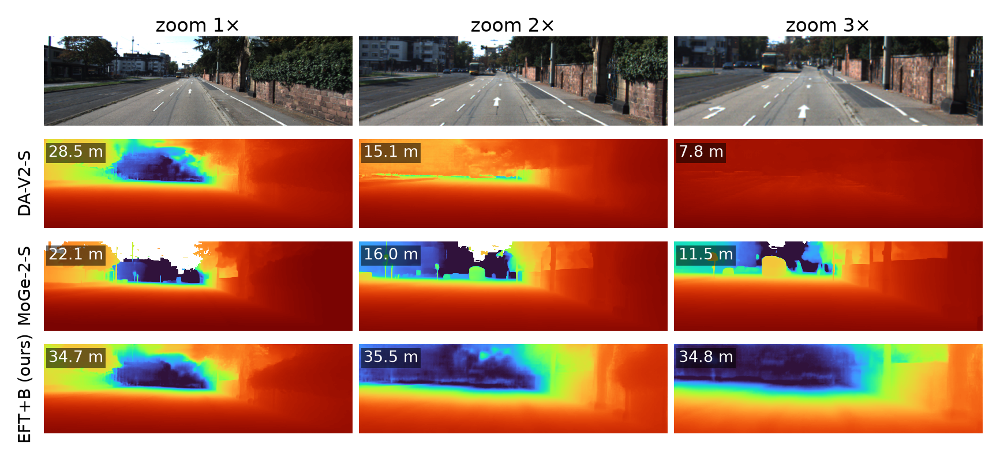

# Zoom equivariance of metric depth models

Code, results and paper for *Zoom In, Scale Out: Metric Depth Models Mistake Digital Zoom for Moving Closer*
(CVPR 2027 submission, under double-blind review: do not link this repository from the paper).



**Main results** (800 images from KITTI, NYUv2 and DIODE):

- Depth Anything V2 has α = 0.95: it reads a zoom almost entirely as moving closer.
- Models that predict their own camera close only part of the gap (α ≈ 0.31–0.36), and their focal grows too little.
- Given the true camera, Depth Pro and DA3-Nested keep their depth (α ≈ 0): the error is in the focal head.
- FocalUnshrink, a label- and training-free correction, brings Depth Pro to α = 0.04.
- Self-consistency fine-tuning with a blur-invariance term (EFT+B) brings DA-V2-S to α = 0.05 on KITTI and 0.07 on NYUv2.

A centred crop followed by a resize is an exact digital zoom: the focal length is multiplied by the zoom
factor s and the depth of the scene does not change. Fitting the predicted depth and focal to powers of s gives
two label-free exponents per image:

- **α**, the depth exponent: depth ∝ s^-α, ideal 0;
- **β**, the focal exponent: focal ∝ s^β, ideal 1.

The repository measures both for current metric depth models, explains where the error comes from, and corrects it
without depth labels.

| Part | What it does | Code |
|---|---|---|
| Audit | α, β, errors against ground truth under zooms 1–3× on KITTI, NYUv2, DIODE | `src/audit.py`, `scripts/run_audit.py` |
| Camera intervention | the same networks given the true focal; α+β = 1+α_K for Depth Pro and DA3-Nested | `scripts/make_paper_numbers.py` |
| Cue split | a 2× zoom split into lost context and magnification | `src/audit.py` (`--cues`) |
| Semantic regions | α on objects of familiar size vs walls/floors/roads (SegFormer-B5, ADE20K) | `src/regions.py` |
| Calibration reference | GeoCalib's focal exponent under the same zooms | `src/models.py` (`geocalib`) |
| Real optical zoom | α and β on SR-RAW, static scenes shot at several focal lengths, against the same zoom done digitally | `src/srraw.py` |
| FocalUnshrink | training- and label-free inversion of a focal head's shrinkage (β̂ by self-zoom, μ from unlabeled target images) | `src/analysis.py` (`focal_deshrink`) |
| EFT / EFT+B | fine-tuning DA-V2-S with a zoom self-consistency loss (+ blur invariance) | `src/eft.py`, `scripts/train_eft.py` |
| EFT-S | frozen network + one learned log-scale per image | `scripts/eft_scale.py` |
| EFT-F | Depth Pro's focal head tuned with a focal-consistency loss; depth network untouched | `src/eft_focal.py`, `scripts/train_eft_focal.py` |
| JPEG with zoom | JPEG 75 after a 2× zoom and a 2× zoom of a JPEG, against the plain zoom, complete test sets | `src/audit.py` (`--jpeg-zoom`) |

## Layout

```
zoom-equivariance/
├── src/                  library code
│   ├── zoom.py           exact crop/resize geometry and the zoomed intrinsics
│   ├── datasets.py       KITTI val selection, NYUv2 test (654), DIODE val indoor/outdoor; fixed image samples
│   ├── models.py         one predict(img, K) -> {depth, fx} interface for every model and fine-tuned variant
│   ├── audit.py          per image and zoom: self-consistency, focal, errors against GT; controls; cue split
│   ├── regions.py        per-region depth ratios from a semantic segmentation
│   ├── srraw.py          real optical vs digital zoom on SR-RAW
│   ├── eft.py            EFT / EFT+B / EFT-S trainers
│   ├── eft_focal.py      EFT-F: focal-consistency loss on Depth Pro's focal head (cached frozen features)
│   ├── analysis.py       α/β fits, bootstrap intervals, summaries
│   └── plotstyle.py      figure style
├── scripts/              command-line jobs (each one runs on its own; heavy ones on Kaggle)
├── kaggle/templates/     kernel bodies; scripts/kaggle_build.py packs src/ + scripts into one kernel
├── notebooks/            analysis notebooks (jupytext .py + executed .ipynb)
├── tests/                unit tests (no model weights needed; CI runs them on every push)
├── outputs/results/      every result CSV the paper is built from
├── outputs/eft/          training logs (checkpoints are not in git)
└── paper/                LaTeX: main.tex (anonymous), main_named.tex, supp.tex, sec/, gen/ (generated)
```

## Setup

```bash
python -m venv .venv && . .venv/bin/activate
pip install torch --index-url https://download.pytorch.org/whl/cpu   # or a CUDA build
pip install -r requirements.txt
git clone --depth 1 https://github.com/lpiccinelli-eth/UniDepth.git third_party/UniDepth
pip install --no-deps -e third_party/UniDepth
git clone --depth 1 https://github.com/YvanYin/Metric3D.git third_party/Metric3D
pytest && ruff check .
```

## Reproducing

All heavy runs went through Kaggle kernels. `scripts/kaggle_build.py <user> <kind> <part>` writes one kernel
that downloads the data, installs the models and runs a list of jobs; `kaggle kernels push -p kaggle/build/<kind>_<part>`
starts it. Pass the Kaggle credentials as the `KAGGLE_USERNAME` / `KAGGLE_KEY` environment variables; no key is
stored in this repository.

| Kernel (`kind part`) | What it runs |
|---|---|
| `audit a2`, `audit b` | main audit: 8 models × 4 sets × 200 images (b: Depth Pro, off-centre zooms) |
| `audit c1`, `audit c2` | larger and newer models (DA3, UniK3D, VGGT, …) |
| `audit d` | optical-vs-digital, interpolation and JPEG controls; fine ZoomFix grid |
| `audit fulla`, `audit fullb` | main models on the complete test sets (`results/*__full.csv`; supplement table `tab:full`) |
| `eft`, `eft baseline`, `eft ablate`, `eft seeds` | EFT, EFT+B, controls, three training seeds |
| `tpu main` | cue split and EFT-S on the CPU cores of a TPU VM |
| `tpu camgpu` | MoGe-2 / UniDepthV2 given the true camera; Depth Pro cue split |
| `tpu calib` | GeoCalib reference and semantic-region α |
| `tpu focal` | EFT-F training and audit; SR-RAW real optical zoom |
| `tpu full` | main models except Depth Pro on the complete test sets, as image shards on the TPU VM's CPU cores (merged at the end; CPU fallback for `audit fulla`) |
| `tpu figs <seq>` | Figure 1 maps of EFT+B, SR-RAW maps of one sequence, SR-RAW inventory (`scripts/srraw_check.py`) |
| `audit jzgpu-a`, `audit jzgpu-b` | JPEG with a 2× zoom on the complete test sets (`results/*__jzfull.csv`; b: Depth Pro) |

When a kernel is done:

```bash
kaggle kernels output <user>/zoom-equivariance-<kernel> -p /tmp/out
cp /tmp/out/results/*.csv outputs/results/
python scripts/make_paper_numbers.py      # every number and table of the paper -> paper/gen/
python scripts/kaggle_paper.py <user>     # compiles the paper on a Kaggle CPU kernel (no local LaTeX needed)
python scripts/abstract_text.py           # plain-text abstract with the numbers filled in -> paper/gen/abstract.txt
```

Every number in the paper is a LaTeX macro written by `scripts/make_paper_numbers.py` from the CSVs in
`outputs/results/`; none is typed by hand.

## Data

Only public data is used, downloaded by the kernels from the original sources:

- KITTI depth selection (val) and raw drives disjoint from it (unlabeled training images): cvlibs.net/datasets/kitti
- NYU Depth v2 labelled set and official split: cs.nyu.edu/~silberman/datasets/nyu_depth_v2.html
- DIODE val: diode-dataset.org
- SR-RAW test set (Zhang et al., CVPR 2019; CC BY-NC 4.0): github.com/ceciliavision/zoom-learn-zoom. Its 50 sequences
  are used; the `aligned/` subfolders (pre-aligned crops without EXIF) are not.

Model weights come from their official Hugging Face or GitHub releases (see `src/models.py`).

- `DATA.md`: every data source, what is used from it, its ground truth and terms; the exact image ids of every
  sample are in `outputs/samples/` (`scripts/export_samples.py`, which also checks the train/test drive split).
- `CHECKPOINTS.md`: every checkpoint and fine-tuned variant with its training configuration.
- `requirements-lock.txt`: the exact package versions behind every result (`requirements.txt` is the short list).

The title, abstract, authors and keywords for the submission form are in `SUBMISSION.md`.

## License

Code: MIT (see `LICENSE`). Datasets and model weights keep their own licenses.
